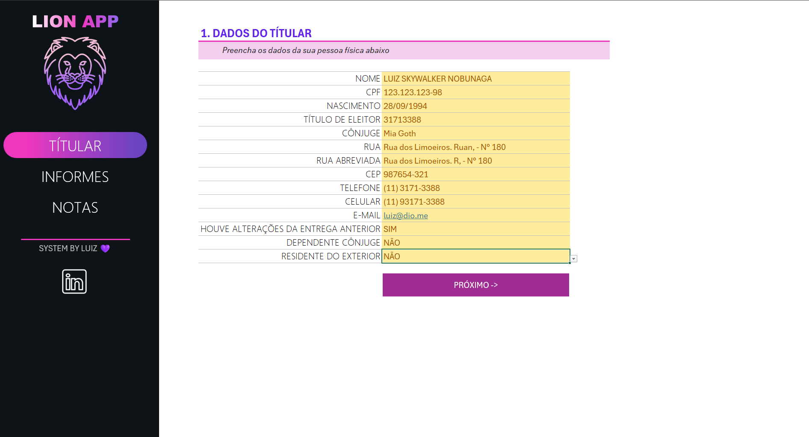
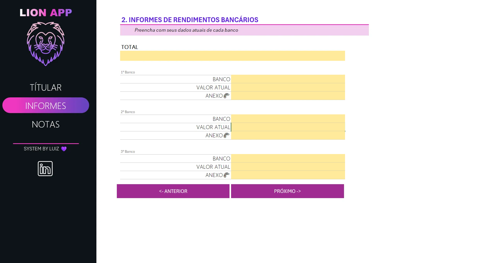
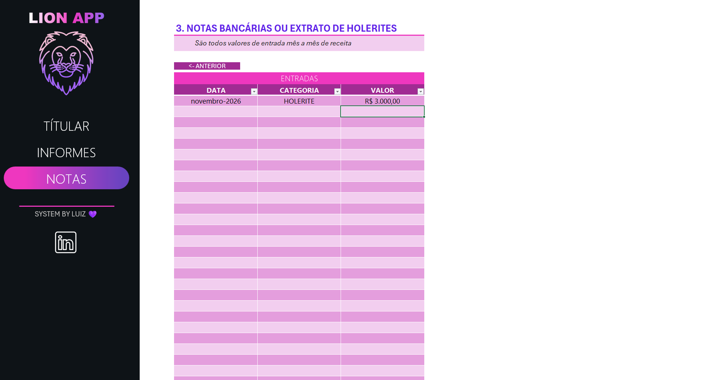

# Declarador de Imposto de Renda — Lion App

Projeto desenvolvido no **Microsoft Excel** para organizar e centralizar informações que podem ser utilizadas como apoio na preparação da declaração de Imposto de Renda da Pessoa Física (IRPF).

A planilha reúne dados cadastrais do titular, informações de rendimentos bancários e registros mensais de entradas financeiras em uma interface personalizada, com navegação entre as seções e campos de preenchimento identificados.

## Objetivo

Criar um organizador simples e visual para reunir informações financeiras e cadastrais em um único arquivo, facilitando a consulta e a conferência dos dados durante a preparação da declaração.

## Funcionalidades

- **Dados do titular:** espaço para registrar informações pessoais, documentos, endereço, contatos e algumas informações complementares.
- **Informes de rendimentos bancários:** cadastro do banco, valor atual e identificação do arquivo de comprovante correspondente.
- **Total bancário automático:** fórmula que soma os valores informados nos três registros bancários já disponibilizados na planilha.
- **Notas e entradas mensais:** tabela para registrar data, categoria e valor de cada entrada financeira, como holerites e outras fontes de receita.
- **Validação de dados:** listas de seleção para campos de resposta `SIM/NÃO` e para as categorias de entradas disponíveis na planilha.
- **Aba auxiliar de bancos:** relação de instituições financeiras para consulta durante o preenchimento.
- **Interface personalizada:** identidade visual Lion App, menu lateral e botões de navegação entre as áreas da planilha.

## Estrutura da pasta de trabalho

| Aba | Descrição |
|---|---|
| `TÍTULAR` | Reúne os dados cadastrais e informações complementares do titular. |
| `INFORMES` | Organiza até três registros bancários, com banco, valor atual e referência ao arquivo de comprovante. Apresenta a soma dos valores cadastrados. |
| `NOTAS` | Permite registrar entradas financeiras por data, categoria e valor. |
| `Tabelas` | Contém a lista auxiliar de instituições financeiras utilizada como referência. |

## Demonstração

As imagens abaixo apresentam as principais telas da planilha. Os valores preenchidos foram ocultados nas capturas para evitar a divulgação de informações pessoais ou financeiras em um repositório público.

### 1. Dados do titular



### 2. Informes de rendimentos bancários



### 3. Notas bancárias e entradas mensais



## Como utilizar

1. Baixe o arquivo `DeclaradorImpostodeRenda.xlsx` e abra-o no Excel.
2. Preencha a aba **TÍTULAR** com os dados cadastrais correspondentes.
3. Na aba **INFORMES**, informe as instituições financeiras, os valores atuais e o nome ou identificação dos respectivos comprovantes.
4. Na aba **NOTAS**, registre as entradas financeiras usando data, categoria e valor.
5. Confira os dados informados e mantenha os documentos comprobatórios organizados em local seguro.

> **Atenção:** o campo de anexo serve para identificar o arquivo do comprovante; não significa que o documento esteja automaticamente incorporado à planilha. O total bancário está configurado para somar os três registros existentes no modelo.

## Tecnologias e recursos utilizados

- Microsoft Excel (`.xlsx`)
- Formatação de células e organização de tabelas
- Fórmulas do Excel
- Validação de dados
- Interface visual com elementos de navegação
- Git e GitHub para versionamento e documentação do projeto

## Estrutura do repositório

```text
.
├── DeclaradorImpostodeRenda.xlsx
├── README.md
└── imagens
    ├── 01-dados-do-titular.png
    ├── 02-informes-bancarios.png
    └── 03-notas-e-entradas.png
```

## Observações

- Este projeto é um **organizador de informações** e um exercício prático de Excel. Ele não gera nem transmite a declaração oficial do IRPF, não substitui o programa da Receita Federal e não deve ser tratado como ferramenta de cálculo ou validação tributária.
- Confira os dados com os informes e documentos oficiais antes de utilizá-los na declaração.
- O arquivo disponibilizado contém valores de demonstração. Substitua-os pelos dados corretos antes do uso e revise o conteúdo antes de publicar sua própria versão.
- Não publique CPF, endereço, telefone, saldos bancários, holerites ou outros documentos reais em repositórios públicos.

## Desafio DIO

Projeto desenvolvido como prática do desafio da **Digital Innovation One (DIO)**, com foco na construção de uma ferramenta no Excel e na documentação do projeto por meio do GitHub.
